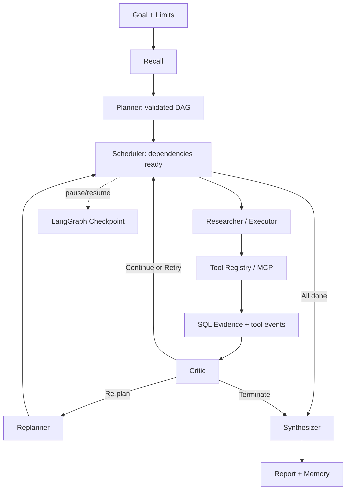

# 需求、选型与源码对应

## 输入输出及验收

| 简历要点 | 具体输入 → 输出 | 实现位置 | 运行验证 |
|---|---|---|---|
| Planner DAG | goal、工具 Schema → 带依赖 steps | `schema.py:Plan.valid_dag`、`runtime.py:_planner` | demo；循环依赖/未知 ID 测试 |
| 多 Agent Workflow | 就绪任务 → Researcher/Executor → Critic → 汇总 | `runtime.py:_build_graph/_scheduler/_execute/_critic/_synthesize` | `run`、`inspect --events` |
| Continue/Retry/Re-plan/Terminate | 最新证据/失败 → decision + reason | `runtime.py:_critic/_replan/_limit` | 超时注入、重规划、预算测试 |
| 预算和完成条件 | token、轮数、工具调用数、活动时间限制 → completed/terminated/failed | `config.py`、`model.py:JsonModel.ask`、`runtime.py:_limit` | token/call/iteration 测试 |
| Tool Registry | 工具能力、参数 → 标准结果/错误 | `tools.py:Tool/Registry` | Schema、未知工具、空结果测试 |
| Web/RAG/SQL/Code | query/表达式 → 文档/行/计算结果 | `tools.py:build_registry` | 完整 demo；只读 SQL、AST 拒绝测试 |
| MCP Gateway | 可信服务配置、白名单 → 注册远程工具 | `mcp_gateway.py:MCPGateway` | 真正 stdio SDK list/call 测试 |
| 错误恢复 | timeout/429/empty/failure → 重试/降级/反思 | `tools.py:Registry.execute` | 故障注入与真实异步超时取消 |
| Working State | 有界证据摘要、计划、状态 → 下一节点输入 | `runtime.py:State`、`model.py:pack_context` | inspect 对比数据库完整 Evidence |
| Checkpoint | thread_id → 持久化图状态 | `runtime.py:Runtime` | 新 Runtime 恢复测试，SQLite/PG 各验证 |
| Long-term Memory | namespace/query → 跨会话向量召回 | `memory.py:Memory` | 命名空间隔离、PG vector 检索测试 |
| SQL 审计 | plan/evidence/tool/model/node → 事件日志 | `storage.py:Store` | inspect 与 traces.jsonl |
| 回放评测 | 保存的轨迹 + gold → 指标 | `evaluation.py:score/replay` | replay 等于原评分；错误 gold 必须失败 |
| 对照与消融 | 同一任务 → full/react/no_critic/no_memory | `evaluation.py:run_evaluation` | 60 × 4 次运行、原始结果文件 |
| LangSmith | task/node/tool/model → 云 Trace | runtime/model/tools 的 `traceable` 与图追踪 | scripts/langsmith_smoke.py 已上传并读回真实云端记录 |

用户请求进入 CLI 后，Runtime 建立同一 thread 的持久化图；Recall 读取记忆，Planner 给出 DAG；Scheduler 只释放依赖已完成的节点。Researcher/Executor 调用 Registry，Registry 产生完整工具事件和 Evidence。Critic 读摘要决定路由：Continue 才将 step 标记完成，Retry 回 Scheduler，Re-plan 保留已完成步骤并修订待办，Terminate 产出不完整状态。所有依赖完成后 Synthesizer 输出报告，成功摘要写入长期记忆。



DAG 负责“谁依赖谁”，Agent Loop 负责“当前证据是否足够、下一步策略是否需要改变”。当前每次选择一个就绪步骤，串行执行以便复现，不宣称 DAG 层已实现分布式并发。评测任务之间的并发与 DAG 内并发是两个独立概念。

## 已阅读的真实候选仓库

检索方式：agent-reach 指定的 GitHub CLI `gh search repos`、`gh api`，并核对官方库文档。调研日期 2026-09-28。

| 候选与固定版本 | 阅读的核心代码 | 已有能力 | 对本任务仍需改造 |
|---|---|---|---|
| [langchain-ai/open_deep_research](https://github.com/langchain-ai/open_deep_research/tree/1b7d2e80db9faa586165c60e09096dbbfd483a64)，MIT | `src/open_deep_research/deep_researcher.py` 中 supervisor、supervisor_tools、researcher、researcher_tools、最终 StateGraph；`utils.py` 中 load_mcp_tools/get_all_tools | supervisor 委派研究员、并行研究、搜索/MCP、压缩证据、汇总报告、循环上限 | 显式依赖 DAG、统一 SQL 审计、工具治理策略、可检查的 Critic 路由、持久化恢复配置、统一四组评测仍需新增或改造 |
| [langchain-ai/local-deep-researcher](https://github.com/langchain-ai/local-deep-researcher/tree/ba505ffc3d7e897bc48b6169fa2cb1ec859dd38d)，MIT | `src/ollama_deep_researcher/graph.py` 中 generate_query/web_research/summarize_sources/reflect_on_summary/route_research | 本地模型、多种搜索、检索→总结→反思循环、来源去重 | 多角色 DAG、MCP、通用执行工具、关系数据库持久化、长期向量记忆、比较评测需大幅新增 |

选择从零实现应用层：本任务核心是可讲解的运行时治理和严谨对照，不只是生成长报告。直接改造以上项目，会同时保留原有控制逻辑并引入新的状态、预算和审计逻辑，增加需要解释的分支。这里直接复用公开基础库的图、检查点、协议和数据库适配，不复制上游业务代码。因此“原项目已有能力”和“本次新增”界限明确：所有 `src/agentforge` 应用逻辑均为本次新增；图执行、检查点格式、MCP wire protocol、SQL 驱动由依赖库提供。

## 文件结构

```text
src/agentforge/
  config.py          环境参数
  schema.py          DAG、模型返回值及引用校验
  runtime.py         StateGraph、调度、Critic、baseline、恢复
  tools.py           Registry 与工具实现
  mcp_gateway.py     MCP SDK 适配
  sample_mcp.py      合成政策 MCP 服务
  storage.py         审计、完整 Evidence 和运行投影
  memory.py          命名空间记忆、hash/API embedding、pgvector
  model.py           JSON 模型调用、上下文打包、Token 计量
  fixtures.py        10 模板 × 6 领域数据生成
  evaluation.py      执行、评分、回放、聚合
  cli.py             初始化、运行、恢复、检查与评测入口
fixtures/            检入的语料、60 任务、两个 demo
tests/               核心、工具、模型、PG、Docker、回放测试
reports/             本次真实产生的原始实验和测试输出
```

本项目当前属于单机研究原型：没有认证 API 服务、任务队列、分布式锁、多租户授权、自动检查点保留策略或生产迁移系统。写在简历上时应描述已完成的 Harness 机制与具体测试，避免扩展成未经实现的生产平台。
